

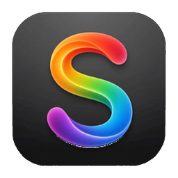

# Snap Studio

**L'atelier de bureau de votre Snapmaker U1 — du fichier à l'impression.**

[**Télécharger**](https://github.com/kameka22/snap-studio/releases/latest) ·
[Fonctions](#fonctions) · [IA](#concevoir-avec-lia) · [FAQ](#faq) ·
[Changelog](CHANGELOG.md) · [Feuille de route](#feuille-de-route) · [Contribuer](CONTRIBUTING.fr.md)

[English](README.md) · **Français**

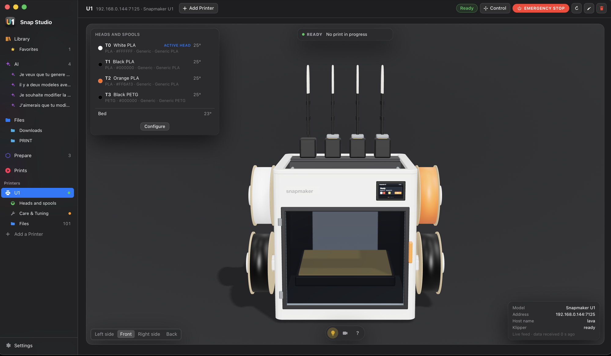

Votre U1 en 3D : cliquez une bobine, une tête, le plateau ou la lumière pour en ouvrir les contrôles.

## Pourquoi Snap Studio

- **Tout le trajet dans une seule app** — trouver un modèle, préparer le
  plateau, découper avec le moteur Snapmaker Orca, envoyer, suivre à la
  caméra.
- **Pensé pour les quatre têtes de la U1** — les bobines chargées sont lues
  sur l'imprimante, les couleurs d'un modèle multicolore sont associées aux
  têtes, et revérifiées avant le lancement d'une impression.
- **Plus de couleurs que de têtes** — mélangez deux bobines en une
  nouvelle couleur, et donnez une tour d'amorçage à chaque groupe de
  matériaux qui n'adhèrent pas entre eux (PLA et PETG…).
- **Concevoir avec l'IA** — décrivez une modification ou une nouvelle
  pièce ; Claude la modélise, vous la voyez prendre forme en 3D, version
  après version.
- **En neuf langues** — français, anglais, allemand, espagnol, portugais
  du Brésil, italien, japonais, chinois simplifié et coréen.

## Fonctions

**Du fichier à l'impression :** [Explorer](#-explorer) ·
[Fichiers](#-fichiers) · [Préparer](#-préparer) ·
[Mélange de couleurs](#-mélange-de-couleurs) ·
[Une tour par matériau](#-une-tour-par-matériau) · [Créer](#-créer) ·
[Découpe](#️-découpe) · [Vérification des bobines](#-vérification-des-bobines) ·
[Impressions](#-impressions) · [Caméra](#-caméra) 
**Votre imprimante :** [Vue 3D](#-votre-imprimante-en-3d) ·
[Contrôle](#-contrôle) · [Entretien](#-entretien) · [Nivellement](#-nivellement) ·
[Fichiers de l'imprimante](#-fichiers-et-timelapses-de-limprimante) · et
l'[Affichage](#-affichage)

### 🧭 Explorer

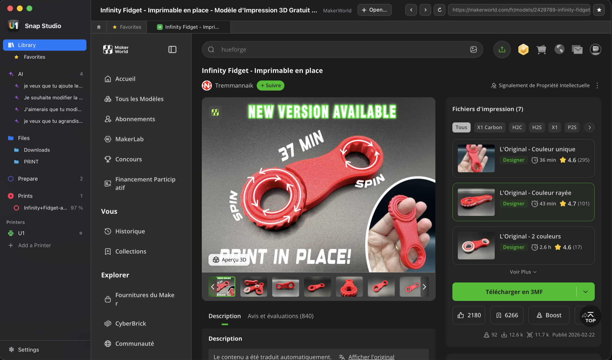

L'écosystème Snapmaker et les sites de modèles que vous utilisez, dans
l'app.

- Une page d'accueil avec Snapmaker Space, Store, Wiki, Forum et Compte,
  et huit bibliothèques de modèles : MakerWorld, Printables, Thingiverse,
  Cults3D, MyMiniFactory, Thangs, Yeggi et GrabCAD. Chacun s'ouvre dans un
  onglet, sessions conservées. Explorer n'affiche que les pages des sites
  eux-mêmes : rien n'en est lu.
- Pas de barre d'adresse : Précédent, Suivant et Recharger flottent sur
  la page.
- Épinglez n'importe quel site dans la barre latérale, sous Snapmaker
  Space ; les favoris y sont aussi.
- Un modèle téléchargé depuis un onglet va droit dans
  [Préparer](#-préparer) ; les autres fichiers arrivent dans
  [Fichiers](#-fichiers).

 

### 📁 Fichiers

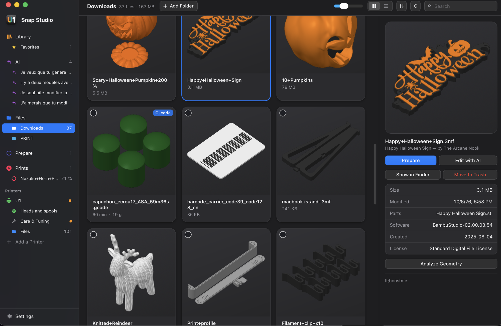

Vos fichiers 3MF en un coup d'œil.

- Miniatures de vos fichiers 3MF (Orca, Bambu, Prusa, MakerWorld), ou rendu
  3D quand il n'y en a pas.
- Durée, filament, plateaux.
- Visionneuse 3D et trajectoires G-code couche par couche.

 

### 🧩 Préparer

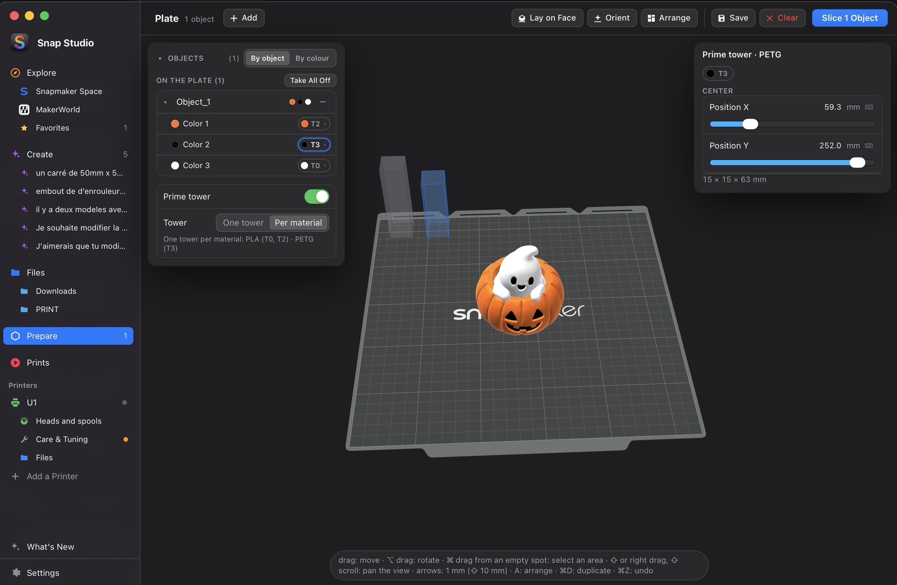

Le plateau U1 comme dans Orca — puis découper.

- Déplacer, pivoter, mettre à l'échelle (aussi axe par axe) avec des
  curseurs ; dupliquer, poser sur une face, orienter et disposer
  automatiquement, annuler.
- Des objets peuvent être mis de côté hors du plateau (non découpés) et
  remis d'un clic.
- Chaque objet liste ses couleurs, peintes comprises, et envoie chacune vers
  la tête de votre choix, montrée avec la couleur et la matière de sa bobine.
- **Tour d'amorçage** : avec deux têtes ou plus, un
  interrupteur sous la liste des objets (désactivé sur chaque nouveau
  plateau, le même réglage que dans la fenêtre de découpe) montre la tour
  sur le plateau, une boîte grise placée dans un coin libre. Elle se déplace
  et pivote comme une pièce ; sa taille est estimée, puis réelle après la
  découpe. Une tour sur une pièce ou hors du plateau est signalée, avec une
  correction.
- [Une tour par matériau](#-une-tour-par-matériau) quand les matériaux
  n'adhèrent pas entre eux, et les [têtes virtuelles](#-mélange-de-couleurs)
  dans les choix de tête.

 

### 🌈 Mélange de couleurs

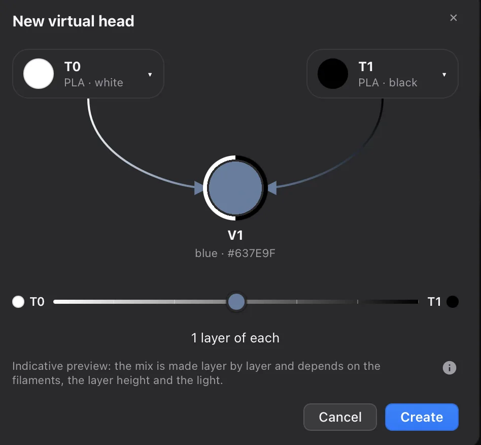

Deux bobines, une nouvelle couleur : le *Full Spectrum* de Snapmaker Orca,
intégré.

- Dans Têtes et bobines, choisissez deux bobines chargées et réglez le
  mélange avec un seul curseur, de 4:1 à 1:4 : les têtes alternent couche
  par couche.
- La nouvelle **tête virtuelle** (V1, V2…, jusqu'à 8 par imprimante) est
  proposée dans les choix de tête de Préparer, comme une vraie.
- Des matériaux qui n'adhèrent pas entre eux ne se mélangent pas. Si l'une
  de ses bobines est déchargée, la tête virtuelle disparaît ; ce qui
  l'utilisait attend une nouvelle tête avant la découpe.

 

### 🗼 Une tour par matériau

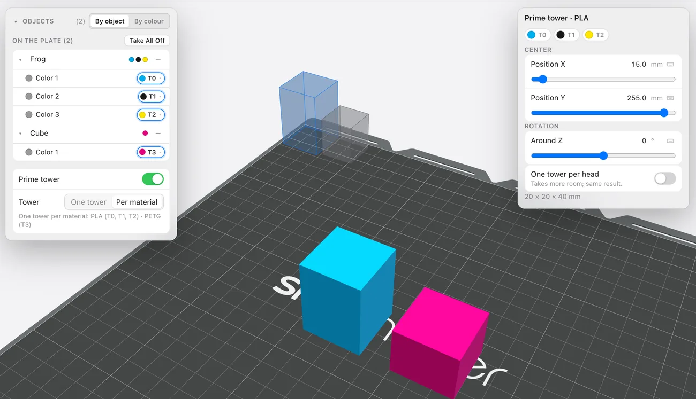

Du PLA et du PETG sur un même plateau, sans tour d'amorçage qui se décolle.

- Une tour unique empile tous les matériaux ; s'ils n'adhèrent pas entre
  eux, elle peut se décoller. Sous **Tour d'amorçage**, choisissez **Par
  matériau** plutôt que **Une tour** : de petits piliers, un par groupe de
  matériaux qui adhèrent, avec un anneau par tête (ou un pilier par tête).
- Proposé seulement quand deux matériaux du plateau n'adhèrent pas entre
  eux, et dans l'alerte de tour de la fenêtre de découpe ; la tour unique
  reste le choix par défaut.
- Placés dans un espace libre et déplacés un par un ; tailles
  automatiques. Refaits à chaque découpe, jamais enregistrés dans le 3MF.

 

### ✦ Créer

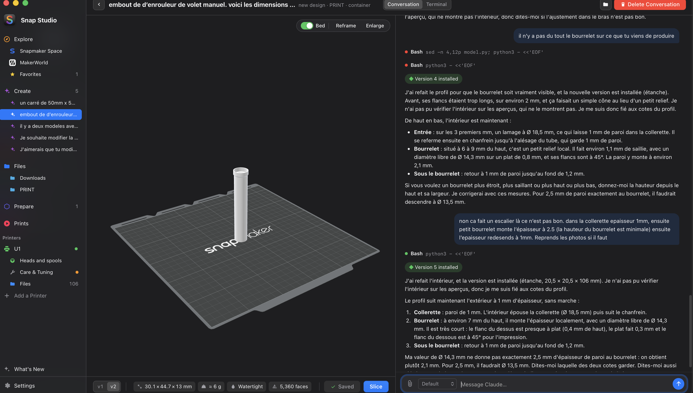

Claude modifie une pièce ou en crée une à partir d'une description.

- Une discussion avec aperçu 3D en direct, chaque version gardée.
- Les résultats sont des 3MF multicolores, prêts à découper.
- Les conversations se recherchent, s'épinglent, se renomment, se
  dupliquent ; voir [Concevoir avec l'IA](#concevoir-avec-lia).

 

### ✂️ Découpe

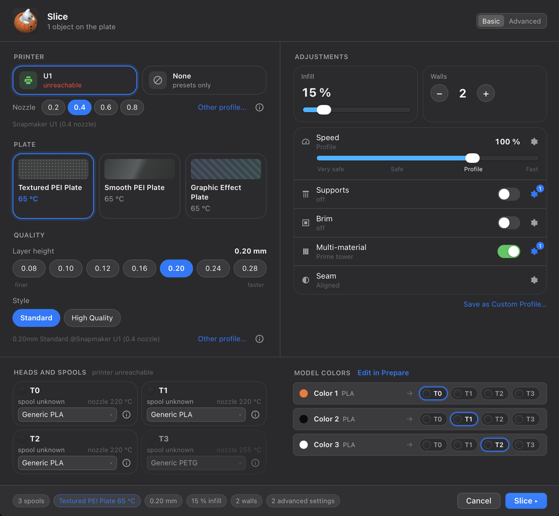

Le moteur Snapmaker Orca, intégré : inutile d'installer Snapmaker Orca.

- L'imprimante, le plateau et la qualité à gauche, les ajustements à
  droite, les quatre têtes de la U1 et les couleurs du modèle en dessous.
- Chaque couleur de chaque objet envoyée vers sa tête, d'après les bobines
  lues sur l'imprimante.
- **Essentiel** ou **Avancé**, dans la barre de titre de la fenêtre ou
  Réglages → Préparer : Essentiel garde l'indispensable, Avancé montre tous
  les réglages.
- **Vitesse** : un seul curseur de 50 % à 120 % du profil.
- Qualité, remplissage, parois, surfaces et plus, avec des styles (supports,
  bordure, couture, motifs) choisis en images.
- Une barre de progression qui suit le travail du moteur, étape par étape.
- Un aperçu des trajectoires, puis l'envoi à l'imprimante ou un G-code
  enregistré.

Plus de détails

Le moteur est téléchargé une fois (environ 30 Mo) et tenu à jour par l'app.
La fenêtre de découpe place l'imprimante, le plateau et la qualité à gauche,
les ajustements à droite, les quatre têtes de la U1 et les couleurs du
modèle en dessous. Elle s'ouvre en **Essentiel** : imprimante, plateau,
qualité, remplissage, parois, vitesse, supports, bordure, couture et
multimatériau. **Avancé** ajoute les panneaux ⚙ (Plus de réglages),
Surfaces, Autres et la prévention des coulures. Les réglages masqués
gardent leur valeur et s'appliquent toujours ; Essentiel indique combien de
réglages avancés sont modifiés, avec un lien pour les afficher :

- les bobines lues sur l'imprimante, chaque couleur de chaque objet envoyée
  vers sa tête, la surface du plateau (PEI texturé, PEI lisse…) et sa
  température ;
- qualité (première couche, largeurs de ligne, précision, surplombs et
  ponts), remplissage (motif en images), parois, **Surfaces** (couches du
  dessus et du dessous, lissage) et **Autres** (séquence d'impression, vase
  en spirale, surface floue, jupe) derrière un ⚙ ; supports, bordure,
  couture et motifs choisis en images ; des champs numériques avec des
  flèches ‹ › (double-clic pour saisir) ; les réglages avancés d'Orca, et
  leur enregistrement en profil perso ;
- **Vitesse** : un seul curseur de 50 % à 120 % du profil (vitesses × f,
  accélérations × f²), avec un panneau ⚙ qui montre chaque valeur, profil →
  calculée ; à 100 %, le G-code est celui du profil ;
- le détail de chaque profil tel que le moteur le reçoit ;
- **multimatériau** : la tour d'amorçage (son propre interrupteur, partagé
  avec Préparer, où elle se place sur le plateau ; la tête de son mur
  extérieur), la prévention des coulures ; un avertissement quand la tour mélangerait des
  matières qui n'adhèrent pas (PLA et PETG, PLA et TPU…), avec des
  corrections en un clic, dont une tour par matériau.

Puis un aperçu des trajectoires avec durée, filament et coût, envoyé à
l'imprimante — avec son image sur l'écran de l'imprimante — ou enregistré en
G-code.

 

### 🎨 Vérification des bobines

Avant le lancement d'une impression, chaque couleur du modèle est comparée à
la bobine chargée sur sa tête.

- Matière, et couleur telle que l'œil la voit.
- En cas d'écart, choisissez une autre tête pour cette couleur — pour cette
  impression seulement.
- Ou **Modifier dans Préparer**, avec les bobines chargées.

Plus de détails

La vérification a lieu que l'impression soit envoyée après une découpe,
lancée depuis la file ou depuis les fichiers d'une imprimante. En cas
d'écart, une fenêtre montre une ligne par couleur avec les têtes possibles :

- choisissez une autre tête, et cette couleur sera imprimée par elle — pour
  cette impression seulement, via la table d'extrudeurs de l'imprimante, le
  G-code n'est pas réécrit ;
- ou **Modifier dans Préparer** : le plateau revient avec la fenêtre de
  découpe ouverte sur les bobines chargées.

La vérification se désactive dans Réglages → Préparer.

### ⏱ Impressions

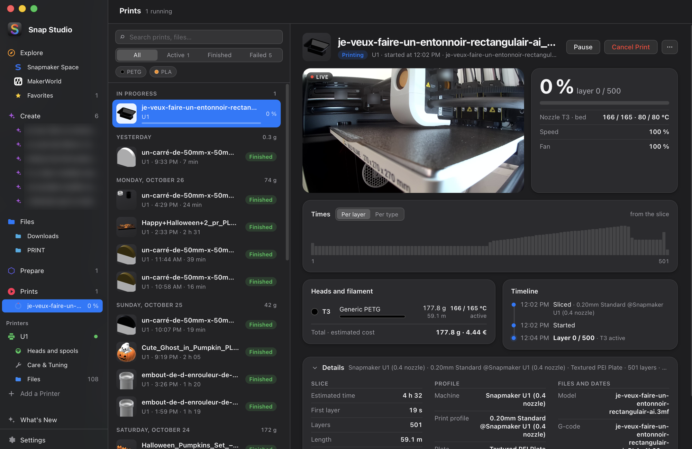

Toutes les impressions, en cours, en attente ou terminées.

- À gauche, les impressions : recherche, filtres, en cours, file d'attente,
  puis jour par jour.
- À droite, la fiche : caméra, progression et temps par couche pendant
  l'impression ; timelapse, résultat et durée réelle contre estimée une
  fois terminée, avec Réimprimer et Ouvrir dans Préparer.
- Quand l'une se termine, Snap Studio propose la suivante (jamais seul), sur
  l'imprimante de votre choix.
- L'historique est gardé pour toujours, ou 30 jours, 90 jours ou un an
  (Réglages → Impressions).
- Avant le lancement, les [bobines sont vérifiées](#-vérification-des-bobines).

 

### 📷 Caméra

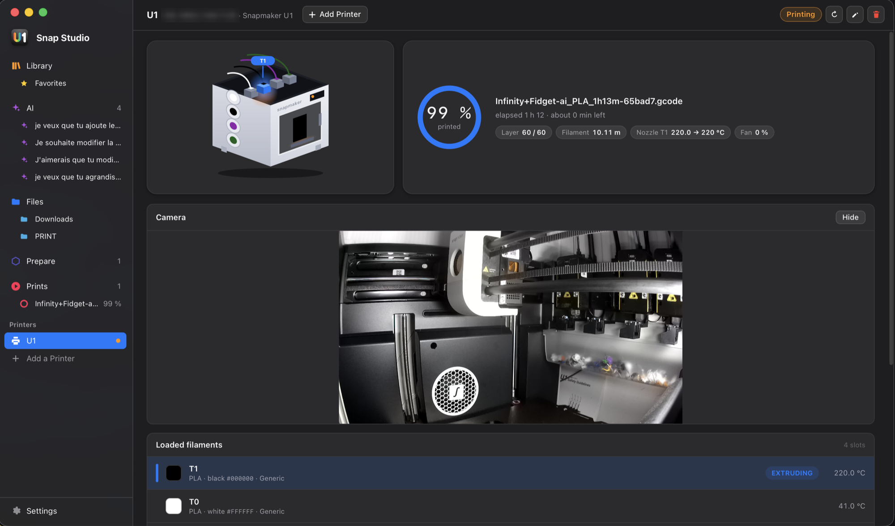

La caméra de l'imprimante, en direct : une seule caméra pour toute l'app.

- La page de l'imprimante, la fiche d'une impression en cours et Contrôle
  montrent la même caméra, avec les mêmes commandes ; le flux continue
  d'un écran à l'autre.
- Trois tailles : une vignette, agrandie, ou en plein écran sur l'app
  (Échap ou un clic à côté de l'image pour en sortir) ; un ✕ l'éteint.
- **Épinglée** : une petite fenêtre qui reste sur tous les écrans pendant
  que vous préparez ou parcourez (sites d'Explorer compris), dans le coin de votre choix ; un clic sur
  l'image ramène à l'imprimante.
- Quand l'imprimante ne répond plus, elle le dit au lieu d'une image figée.

 

### 🖨 Votre imprimante, en 3D

Les imprimantes sont trouvées seules sur le réseau ; la U1 est montrée en 3D.

- Cliquez une bobine, une tête, le plateau ou la lumière : ses contrôles
  rapides s'ouvrent dans un panneau sur la vue.
- État en direct, températures des quatre têtes et bobines chargées ; la
  caméra dans un coin.
- **Toutes les commandes** ouvre [Contrôle](#-contrôle).
- Fonctionne avec toute imprimante Klipper.

Plus de détails

Sous chaque imprimante : **Têtes et bobines**, ses [fichiers et timelapses](#-fichiers-et-timelapses-de-limprimante),
et Entretien et réglages avec ses trois onglets — [Contrôle](#-contrôle),
[Entretien](#-entretien) et [Nivellement](#-nivellement).

**Têtes virtuelles**, dans Têtes et bobines, comme le *Full Spectrum* de
Snapmaker Orca : deux bobines chargées mélangées en une nouvelle couleur,
avec un seul curseur de 4:1 à 1:4 (les têtes alternent couche par couche),
jusqu'à 8 par imprimante. Des matériaux qui n'adhèrent pas entre eux ne se
mélangent pas. Quand l'une de ses bobines est déchargée, la tête virtuelle
est supprimée et ce qui l'utilisait attend une nouvelle tête avant la
découpe.

 

### 🎛 Contrôle

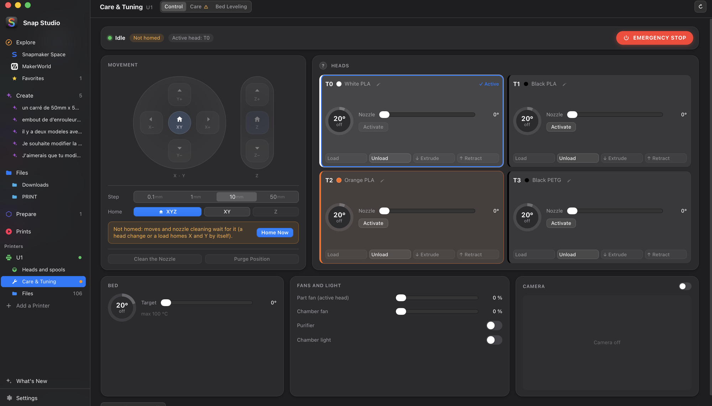

Les actions de base de l'imprimante, sans G-code — le premier onglet
d'Entretien et réglages, aussi accessible depuis la page de l'imprimante
(**Contrôle**).

- Origine et déplacements X, Y et Z (de 0,1 à 50 mm), la position en direct.
- Une carte par tête, à la couleur de sa bobine : température, charger,
  décharger, extruder.
- Plateau, ventilateurs, lumière, une petite vue caméra ; l'arrêt d'urgence
  toujours à portée.
- Sûr par construction : bloqué pendant une impression.

Plus de détails

- Origine (tous les axes ou un seul), un pavé de déplacement X, Y et Z (de
  0,1 à 50 mm), la position en direct ; nettoyer la buse, aller à la
  position de purge.
- Une carte par tête, à la couleur de sa bobine : la température en jauge,
  la consigne au curseur, activer, charger, décharger, extruder, rétracter.
- La température du plateau ; le ventilateur de pièce, celui de la chambre,
  le purificateur et la lumière ; une petite vue caméra.
- Tout couper (chauffe), couper les moteurs, redémarrer le firmware, et
  l'arrêt d'urgence, toujours à portée.
- Sûr par construction : bloqué pendant une impression (seuls l'arrêt
  d'urgence, la lumière et la caméra restent), déplacements et changement de
  tête seulement après l'origine, Z jamais sous 0,5 mm, températures jamais
  au-dessus du maximum de chaque chauffe, une action à la fois ; ce qui ne
  peut pas se faire dit pourquoi.

 

### 🔧 Entretien

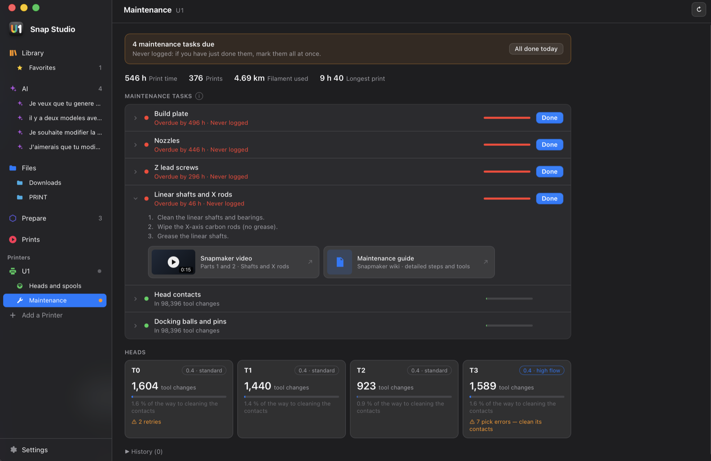

Ce que l'imprimante compte, et le guide de maintenance Snapmaker, dans un
onglet d'Entretien et réglages.

- Utilisation : temps d'impression, impressions, filament, plus longue
  impression.
- Changements de tête, erreurs et hotend de chaque tête (U1).
- Entretiens triés par urgence, chacun avec ses étapes et sa vidéo ; une
  pastille dans la barre latérale quand l'un est à faire.

Plus de détails

- **Utilisation** : temps d'impression, nombre d'impressions, filament
  consommé, plus longue impression.
- **Têtes** (U1) : changements de tête, avancement vers le nettoyage des
  contacts (tous les 100 000 changements), erreurs de prise et nouvelles
  tentatives — une tête en erreur est signalée — et son hotend (standard ou
  haut débit).
- **Entretiens** triés par urgence — contacts des têtes, billes et tiges
  d'accrochage, tiges linéaires et axe X, vis de l'axe Z, buses, plateau —
  avec leur échéance, « dans 80 h » ou « en retard de 296 h ». Chacun se
  déplie sur ses étapes, le passage de la vidéo Snapmaker et le guide ;
  **Fait** le note avec les compteurs du moment, et la prochaine échéance
  part de là (annulable depuis la notification).
- Une pastille dans la barre latérale quand un entretien est à faire. Rien
  n'est écrit dans l'imprimante.

Les contacts suivent le chiffre de Snapmaker ; les autres intervalles sont
des valeurs prudentes, Snapmaker n'en donne pas. Sur une autre imprimante
Klipper, la vue garde l'utilisation et les entretiens à l'heure.

 

### 📐 Nivellement

Le maillage du plateau, lu sur l'imprimante, gardé dans le temps — le
troisième onglet d'Entretien et réglages.

- Une carte dit l'état du plateau et la seule chose à faire.
- La surface en 3D ou en carte, historique et tendance.
- **Mesurer** avec un assistant guidé ; quand le plateau demande de
  l'attention, quoi faire.

Plus de détails

- Une carte dit l'état du plateau et la seule chose à faire : bon (compensé
  par le maillage de l'imprimante), à surveiller, hors tolérance, ou à
  remesurer. Les seuils par défaut (0,5 / 1 mm, trois niveaux) sont adaptés
  au U1, dont le maillage compense ce qui est en dessous ; il ne demande un
  nivellement manuel qu'au-delà de 2 mm.
- La surface en 3D ou en carte avec la hauteur de chaque point ;
  historique, tendance et comparaison de deux mesures.
- **Mesurer** avec un assistant : plateau confirmé dégagé (une impression
  qui vient de finir est signalée), température proposée d'après la
  dernière impression, puis chaque étape du U1 — chauffe, stabilisation de
  2 min, préchauffe, contrôle des coins, palpage — un arrêt propre ou
  d'urgence, et le résultat comparé à la mesure précédente.
- Quand le plateau demande de l'attention, sa forme est nommée et montrée
  sur la carte (côté qui penche, coin plus haut, plateau creux ou bombé,
  point isolé), avec quoi faire — sur un U1, les molettes sous le plateau
  et le nivellement manuel de l'imprimante — puis « J'ai corrigé :
  remesurer ».
- Un rappel dans Entretien après 30 jours ou 50 impressions, et « Mesurer
  d'abord » dans la fenêtre d'envoi quand le plateau est hors tolérance.

### 📂 Fichiers et timelapses de l'imprimante

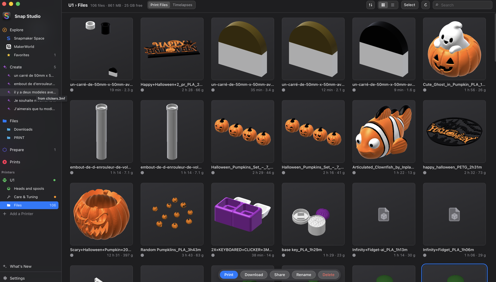

Sous chaque imprimante, **Fichiers** montre ce qui y est stocké, lu en direct.

- Fichiers d'impression en liste ou en grille ; **Imprimer** ouvre la même
  fenêtre qu'après une découpe.
- Timelapses lus directement depuis l'imprimante.
- Partager un fichier ou une vidéo : AirDrop, un QR code pour votre
  téléphone, le presse-papiers.

Plus de détails

- **Fichiers d'impression**, en liste ou en grille : vignette, durée,
  filament par tête, taille, résultat de leur dernière impression ;
  recherche et tri. **Imprimer** ouvre la même fenêtre qu'après une découpe
  — lancer là, mettre en file, ou imprimer sur une autre imprimante — et les
  têtes utilisées sont lues dans le fichier lui-même. Télécharger, renommer,
  supprimer, plusieurs à la fois ; le fichier en cours d'impression est
  protégé.
- **Timelapses**, lus directement depuis l'imprimante (vitesse 0,5×–4×,
  plein écran, précédente / suivante), téléchargés ou supprimés.
- **Partager** un fichier ou une vidéo : le menu de partage de macOS
  (AirDrop, Messages, Mail…), un QR code pour le télécharger sur votre
  téléphone sur le même Wi-Fi (un lien local qui s'arrête après 15 minutes ou
  à la fermeture de la fenêtre), le fichier dans le presse-papiers, ou
  Enregistrer sous.

 

### 🌓 Affichage

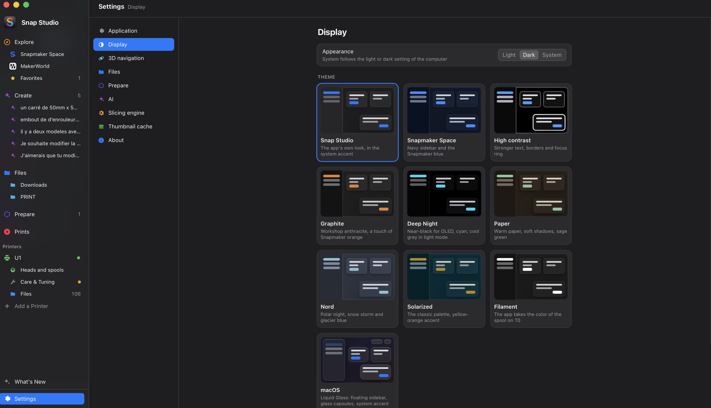

Réglages → Affichage : clair, sombre ou comme le système.

- Dix thèmes, chacun en version claire et sombre avec un aperçu en direct.
- La couleur d'accent : celle du thème, du système, une couleur prédéfinie
  ou la vôtre.
- Des couleurs adaptées au daltonisme, avec tous les thèmes.

Plus de détails

Les dix thèmes : Snap Studio, Snapmaker Space (barre latérale bleu nuit),
Contraste élevé, Graphite, Nuit profonde, Papier, Nord, Solarized, Filament
(l'app prend la couleur de la bobine sur T0) et macOS (une mise en page façon
Tahoe, en verre). Avec les couleurs adaptées au daltonisme, les états ne se
distinguent jamais par le seul rouge / vert.

 

## Télécharger

| Système | Fichier, dans la [dernière version](https://github.com/kameka22/snap-studio/releases/latest) |
|---|---|
| macOS (Intel et Apple Silicon) | `Snap-Studio_…_macos-universal.dmg` |
| Windows | `Snap-Studio_…_x64-setup.exe` |
| Linux | `Snap-Studio_…_amd64.AppImage` (ou `.deb`) |
| Linux ARM (Raspberry Pi 4/5…) | `Snap-Studio_…_arm64.AppImage` (ou `.deb`) — pas encore de moteur de découpe pour ARM |

Les paquets ne sont pas encore signés par Apple ou Microsoft. Premier
lancement sur macOS : clic droit → Ouvrir (ou
`xattr -dr com.apple.quarantine "/Applications/Snap Studio.app"`) ; sous
Windows : « Informations complémentaires » → « Exécuter quand même ».

Ce que chaque version a apporté : [CHANGELOG.md](CHANGELOG.md) (en anglais).

Un **assistant de bienvenue** règle tout : langue (parmi neuf), dossier de modèles,
imprimante sur le réseau, moteur de découpe et IA. Ensuite, **l'app se met
à jour toute seule** (sous Linux, l'AppImage).

## Concevoir avec l'IA

L'IA utilise [Claude Code](https://docs.claude.com/en/docs/claude-code/setup)
avec votre compte Claude, soit dans un bac à sable, soit directement sur
votre ordinateur. Sous macOS et Linux, le bac à sable est **celui de Claude
Code** (intégré) : Claude n'accède qu'au dossier de la conversation, ne lit
rien d'autre dans votre dossier personnel et ses commandes n'ont pas de
réseau. Un **conteneur (yolobox)** reste un choix dans Réglages → IA. Sous
Windows, l'IA tourne sur cet ordinateur. L'assistant de bienvenue et
Réglages → IA vérifient ce dont votre choix a besoin et indiquent comment
installer ce qui manque ; un mode s'ouvre dès que tout est prêt.

| | Bac à sable (intégré) | Conteneur (yolobox) | Cet ordinateur |
|---|---|---|---|
| Claude Code 2.1.286 ou plus récent, connecté | ✓ | ✓ | ✓ |
| Python 3 avec `trimesh`, `manifold3d`, `numpy` | ✓ | | ✓ |
| Linux : `bubblewrap` et `socat` | ✓ | | |
| [yolobox](https://github.com/finbarr/yolobox) | | ✓ | |
| Un moteur de conteneur démarré : Docker (ou OrbStack), Podman ou `container` d'Apple | | ✓ | |

**Une conversation**, à partir d'un fichier (« Modifier avec l'IA » dans
Fichiers) ou de zéro : décrivez ce que vous voulez — des idées sont
proposées — ajoutez des images (croquis, photos : déposées, collées ou
choisies), choisissez où elle tourne et le modèle Claude. L'aperçu 3D et la
discussion sont côte à côte : chaque version exportée par Claude est gardée,
mesurée (taille, poids, étanchéité) et peut être réaffichée ;
**Enregistrer** met la version affichée dans vos fichiers, **Découper**
l'envoie dans Préparer. **Arrêter Claude** (ou Échap) interrompt une
réponse ; l'onglet **Terminal** montre la même session, en direct, comme le
ferait un terminal.

**La liste** des conversations : recherche, filtres, groupes par date,
épingles, renommer, dupliquer (mêmes fichiers, nouvelle session Claude).
**Supprimer** efface le dossier de la conversation et les fichiers de Claude
pour cette session — jamais vos 3MF enregistrés, jamais une autre session.

## FAQ

**Qu'est-ce qui a changé dans les dernières versions ?** Voir le
[changelog](CHANGELOG.md) (en anglais).

**Faut-il Snapmaker Orca ?** Non. Snap Studio télécharge son propre moteur.
Si Snapmaker Orca est installé, ses profils personnalisés sont proposés
aussi.

**Et avec une autre imprimante ?** L'état de l'imprimante et l'envoi
fonctionnent avec toute imprimante Klipper (Moonraker) ; le plateau, les
profils et les têtes sont ceux de la U1.

**Qu'est-ce qui sort de mon ordinateur ?** Aucune télémétrie. Snap Studio
échange avec GitHub (vérifier les mises à jour, télécharger le moteur), vos
imprimantes sur le réseau local, les sites ouverts dans Explorer et,
si vous utilisez l'IA, Anthropic par Claude Code.

**Pourquoi macOS m'avertit-il au premier lancement ?** L'app n'est pas
encore signée avec un certificat de développeur Apple ; les commandes
ci-dessus l'ouvrent quand même.

**J'utilisais 3MF Studio.** C'était l'ancien nom de Snap Studio : réglages,
imprimantes, favoris et conversations sont repris au premier lancement.

## Raccourcis

| | |
|---|---|
| ⌥⌘1 … ⌥⌘4 | Explorer / Créer / Fichiers / Préparer |
| ⌘O · ⌘R · ⌘F | ouvrir un dossier · actualiser · rechercher |
| ⌘1 / ⌘2 | vignettes / liste |
| ⏎ · double-clic | préparer (ajouter au plateau) ; G-code : trajectoires |
| V | vue 3D |
| ⌘⌫ | mettre à la corbeille |
| ⌘, | Réglages |

Dans Préparer : R pivoter, F poser sur une face, Q orienter (⇧Q : tout),
A disposer, ⌘D dupliquer, flèches 1 mm (⇧ : 10 mm), ⌘Z / ⇧⌘Z ; ⌘ + glisser
depuis le vide sélectionne avec un rectangle, ⇧-clic dans la liste
sélectionne une plage.

Dans la liste de l'IA : ⌘F rechercher, ↑ / ↓ et ⏎ ouvrir, F2 renommer,
⌫ supprimer. Dans une conversation : ⌘⏎ envoyer, Échap arrêter Claude.

Dans les fichiers d'une imprimante : ⏎ détail, Échap fermer ; dans le
lecteur : ← / → vidéo précédente / suivante, Espace pause, Échap retour.

## Feuille de route

Ce qui est sorti est dans le [changelog](CHANGELOG.md). Ce qui est prévu,
chacun avec sa pull request (brouillons, validés ou en discussion) :

| Fonction | |
|---|---|
| **Plusieurs plateaux dans Préparer** — onglets de plateaux, agencement automatique sur plusieurs plateaux, tout découper et l'envoyer dans la file ; les 3MF multi-plateaux gardés tels quels | [#18](https://github.com/kameka22/snap-studio/pull/18) |
| **Impression objet par objet** — un objet après l'autre, avec contrôle de collision pour la tête de la U1 et un ordre réglable | [#22](https://github.com/kameka22/snap-studio/pull/22) |
| **Alertes plateau et matière** — un plateau et un filament incompatibles signalés avant d'imprimer, et un conseil quand la colle est recommandée | [#16](https://github.com/kameka22/snap-studio/pull/16) |
| **Assistants de calibration** — PID des buses et du plateau, et input shaper, décalages entre têtes et mesure du débit guidés, dans Entretien et réglages | [#17](https://github.com/kameka22/snap-studio/pull/17) |
| **Filaments** — l'inventaire de vos bobines (poids déduit après chaque impression, alerte de stock bas) et les bonnes affaires | [#19](https://github.com/kameka22/snap-studio/pull/19) |
| **Barre de titre intégrée sous Windows et Linux** — la même fenêtre épurée que sous macOS | [#27](https://github.com/kameka22/snap-studio/pull/27) |
| **D'autres agents IA** — OpenCode à côté de Claude Code (OpenAI, Google, Mistral, modèles locaux…), un seul actif à la fois | [plan](docs/plans/ai-agents.md) |

Les travaux en cours, ce qui reste à vérifier sur une vraie imprimante et les
idées pour plus tard sont dans [`docs/plans/`](docs/plans/) (en anglais). Les
idées sont bienvenues dans les [Discussions](https://github.com/kameka22/snap-studio/discussions).

## Contribuer

Bugs, idées, code ou traductions : voir [CONTRIBUTING.fr.md](CONTRIBUTING.fr.md).
Depuis l'app, **Réglages → À propos** (ou le menu **Aide**) ouvre un
signalement de bug avec la version et le système déjà remplis. Compiler,
publier, l'organisation du code : [docs/DEVELOPMENT.md](docs/DEVELOPMENT.md)
(en anglais).

## Licence et remerciements

Snap Studio est un logiciel libre, sous [GNU General Public License v3](LICENSE)
ou ultérieure. Construit avec [Tauri](https://tauri.app) et Rust.

- Moteur de découpe : [Snapmaker Orca](https://github.com/Snapmaker/OrcaSlicer)
  (AGPL-3.0), lui-même basé sur [OrcaSlicer](https://github.com/SoftFever/OrcaSlicer) ;
  les éléments du plateau U1 viennent de ses profils (AGPL-3.0).
- Bibliothèques de l'interface : [marked](https://github.com/markedjs/marked),
  [DOMPurify](https://github.com/cure53/DOMPurify),
  [xterm.js](https://github.com/xtermjs/xterm.js) — voir `ui/vendor/NOTICE.md`.
- Vue 3D de l'imprimante : [three.js](https://github.com/mrdoob/three.js) (MIT) ;
  le modèle paramétrique de la U1 (`ui/printer3d/`) a été créé par kameka22
  pour Snap Studio (GPL-3.0) — voir `ui/vendor/NOTICE.md`.

Snap Studio est un projet indépendant, ni affilié ni approuvé par
Snapmaker. Snapmaker et U1 sont des marques de leurs propriétaires.
