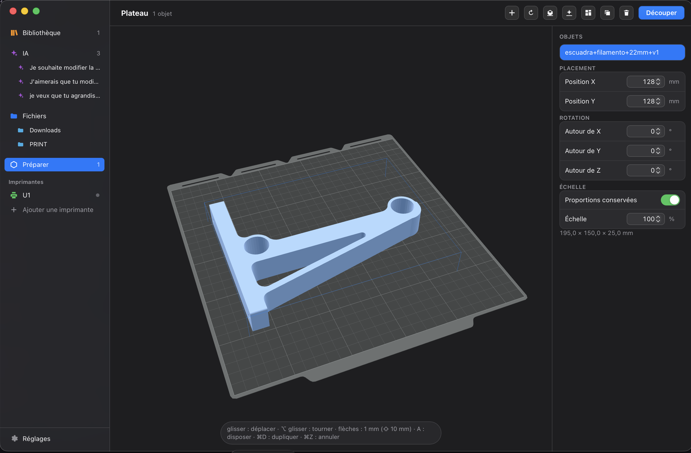

# Snap Studio

**English** · [Français](README.fr.md)

Desktop workshop for the **Snapmaker U1**: browse your 3MF and G-code files,
prepare the plate, slice with the Snapmaker Orca engine and send the print,
without leaving the app.

macOS first (AppKit interface), Windows and Linux too — Rust + Tauri 2, web
interface with no npm dependency. Interface in English and French.



## Features

**Files** — thumbnails extracted from 3MF files (Orca, Bambu, Prusa,
MakerWorld) or rendered in 3D when there are none; metadata (duration,
filament, spools, plates); thumbnails or sortable list, search, multiple
selection, move to Trash; WebGL2 3D viewer; layer-by-layer G-code preview.

**Prepare** — the U1 plate with its pattern, as in Orca. Move, rotate
(rotation rings), scale, duplicate, auto-arrange, lay on face, auto-orient
(Orca's rules), undo / redo, save the plate as 3MF.

**Slicing** — the Snapmaker Orca engine runs in the background. The spools
mounted on the printer are read to pick the filaments, head by head; the
colors of a multicolor model are mapped to the heads. Choice of plate
(textured PEI, smooth PEI, graphic effect), which sets the bed temperature
read from each filament. Details of each profile (ⓘ) exactly as it goes to
the engine, with Orca's tabs in the interface language. Toolpath preview with
duration, filament and cost, then save the G-code or send it to the printer
(bed leveling, flow calibration, timelapse).

**Prints** — running prints and queue in the sidebar. Printer busy? The slice
goes into the queue; when the print ends, Snap Studio offers to start the next
one (never on its own, bed clearance confirmed) and sends a notification.
Record of each print: thumbnail, progress, slicing summary, profiles,
temperatures, camera, pause / resume / cancel; history of the last 20.

**Printers** — automatic discovery of U1 printers on the local network (mDNS,
like Snapmaker Orca); live status over the Moonraker WebSocket: state,
progress, temperatures of the four heads, loaded spools, camera. Works with
any Klipper printer.

**Library** — MakerWorld, Printables, Thingiverse and Cults3D in native tabs,
sessions kept; downloads land in Files; "to print" favorites.

**AI** — Claude Code conversations to create or modify models: a chat view
(streamed answers, tool calls, permission and question cards, plan mode,
sketches and photos attached) or the raw terminal of the same session, with
a live 3D preview and the version history of the result. Results are
multicolor 3MF files — parts with their colors and heads — that slice as
they are. Settings → AI →
Claude account checks the sign-in on the Mac and in the sandbox, signs in
again, or gives the sandbox a long-lived token of its own.

## Installation

Download the latest version from the
[Releases](https://github.com/kameka22/snap-studio/releases):

| System | File |
|---|---|
| macOS (Intel + Apple Silicon) | `…_macos-universal.dmg` |
| Windows | `…_x64-setup.exe` |
| Linux | `…_amd64.AppImage` (or `.deb`) |

The packages are not signed with Apple or Microsoft. On first launch: on
macOS, right-click → Open (or
`xattr -dr com.apple.quarantine "/Applications/Snap Studio.app"`); on Windows,
"More info" → "Run anyway".

On first launch, a **welcome assistant** asks for the language (the system's
is preselected), the models folder, and finds the printer on the network (or
lets you enter it by hand); it stays available from Settings → Application and
the Help menu. On macOS, the network search asks once for local network
access.

Afterwards, **the app updates itself**: at launch it offers the new version,
downloads it, checks its signature and restarts (Settings → Application; Snap
Studio menu → Check for Updates). On Linux, only the AppImage updates itself;
the `.deb` points to GitHub.

**Slicing engine**: Snap Studio does not need Snapmaker Orca installed. When
first needed (welcome assistant or first slice) it downloads its own engine,
about 30 MB: the official [Snapmaker Orca](https://github.com/Snapmaker/OrcaSlicer)
binary, stripped of what slicing does not use (other brands' profiles,
interface, fonts…) and proven by a real slice on each platform. It is stored
in Snap Studio's data (nothing shows in Applications); Settings → Slicing
engine to reinstall or delete it. AGPL-3.0 license, source code linked from
Settings. Snapmaker Orca's custom profiles, if it is installed, are still
offered.

## Development

```sh
cargo tauri dev                    # development
cargo tauri build --bundles app    # local build
npx @tauri-apps/cli icon src-tauri/app-icon.svg -o src-tauri/icons   # icons
```

**Publishing a version**: `scripts/release.sh` (needs the `gh` CLI), on a
clean, up-to-date `main`. It shows the current version and the one to
publish, asks for confirmation, bumps the version (`tauri.conf.json`,
`Cargo.toml`), commits "Version x.y.z", pushes, then starts
`.github/workflows/build.yml`, which builds macOS, Windows and Linux, signs
the packages and publishes the `vx.y.z` release with its `latest.json`.
`--minor` / `--major` to change level, `--version 1.2.3` for an exact version
(newer than the latest); a version not yet published (failed build) is reused
without a bump.

**Changing the engine version**: `scripts/engine.sh 2.5.0` starts the
"Engine" workflow (`.github/workflows/engine.yml`): official package →
allow list (`engine/keep.txt`) → test slice → `engine-orca-2.5.0` release,
then updates `src-tauri/engine.json`. The next Snap Studio release embeds it;
`release.sh` refuses a referenced engine that cannot be found.

Update signing uses the key from the GitHub secrets
`TAURI_SIGNING_PRIVATE_KEY` and `TAURI_SIGNING_PRIVATE_KEY_PASSWORD`; its
public key is in `tauri.conf.json`.

Work plans in progress and ideas for later: [`docs/plans/`](docs/plans/).

### Languages

English is the reference language; French is a translation. Texts live in
`ui/i18n/<lang>.json`, shared by the interface and Rust (menus, messages). To
add a language:

1. copy `ui/i18n/en.json` to `ui/i18n/<code>.json` and translate it;
2. declare it in `src-tauri/src/i18n.rs` (`LANGS`, catalog) and in
   `ui/i18n.js` (`LANG_NAMES`, `LOCALES`);
3. add it to `LANGS` in `scripts/gen-orca-settings.py` and run the script
   again (Orca's tabs), then to `CFBundleLocalizations` in
   `src-tauri/Info.plist` with a `src-tauri/locales/<code>.lproj`;
4. `python3 scripts/check-i18n.py` reports missing or unused keys and text
   left hard-coded.

## Shortcuts

| | |
|---|---|
| ⌥⌘1 … ⌥⌘4 | Library / AI / Files / Prepare |
| ⌘O · ⌘R · ⌘F | open a folder · refresh · search |
| ⌘1 / ⌘2 | thumbnails / list |
| ⏎ · double-click | prepare (add to the plate); G-code: toolpaths |
| V | 3D view |
| ⌘⌫ | move to Trash |
| ⌘, | Settings |

In Prepare: R rotate, F lay on face, Q orient (⇧Q: all), A arrange,
⌘D duplicate, arrows 1 mm (⇧: 10 mm), ⌘Z / ⇧⌘Z.

## Layout

```
ui/               HTML/CSS/JS interface, one file per view
  i18n/           interface texts, one file per language (en, fr)
  i18n.js         translation, number and date formats, language switching
  assets/orca-settings.<lang>.json   Orca's tabs and labels
                  (generated by scripts/gen-orca-settings.py)
  assets/bed/     U1 plate and logo (Snapmaker Orca profiles, AGPL-3.0)
src-tauri/src/
  lib.rs          Tauri commands, mesh:// gcode:// thumb:// cam:// protocols
  plate.rs        plate, scene to slice        orient.rs     auto-orientation
  slice.rs        background slicing           presets.rs    Orca presets
  printers.rs     Moonraker: status, sending   watch.rs      live WebSocket
  model3mf.rs     3MF reading                  write3mf.rs   3MF writing
  mesh.rs stl.rs  geometry                     gcode.rs      G-code parsing
  render.rs       software 3D thumbnails       thumbs.rs     thumbnail cache
  library.rs      Library                      favorites.rs  favorites
  ia.rs pty.rs    AI conversations, terminal   slicers.rs    installed slicers
  ia_tools/       what Claude gets in each workspace: mf.py (3MF), export.py,
                  measure.py, the export-3mf skill
  chat.rs         AI chat view: Claude Code in stream-json mode, log, attachments
  auth.rs         Claude sign-in: sandbox token (Keychain), checks, sign-in terminal
  menu.rs         native menus                 migrate.rs    3MF Studio carry-over
  update.rs       updates (GitHub, signature, installation)
  discover.rs     printer discovery on the network (mDNS)
  jobs.rs         prints: queue, history, background tracking
  engine.rs       bundled slicing engine: download, verification
  access.rs       first access to macOS protected folders (one prompt)
  i18n.rs         interface language, catalogs shared with ui/i18n
```

Snap Studio used to be called 3MF Studio: its data (settings, printers,
favorites, conversations) is carried over on first launch.
