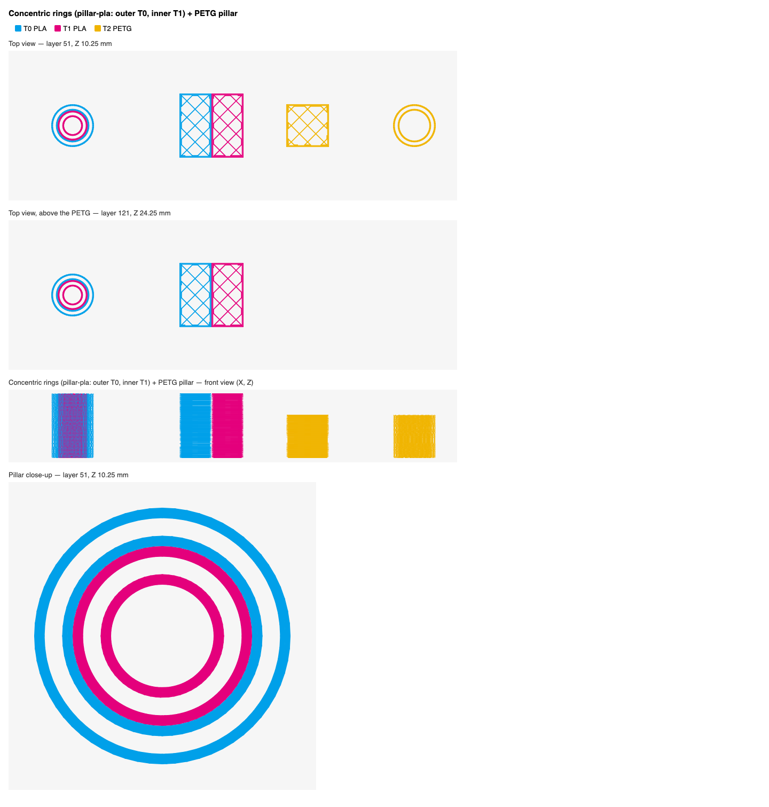
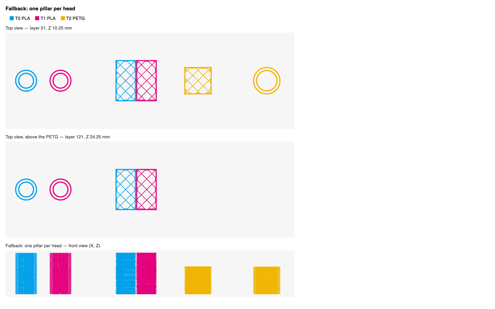
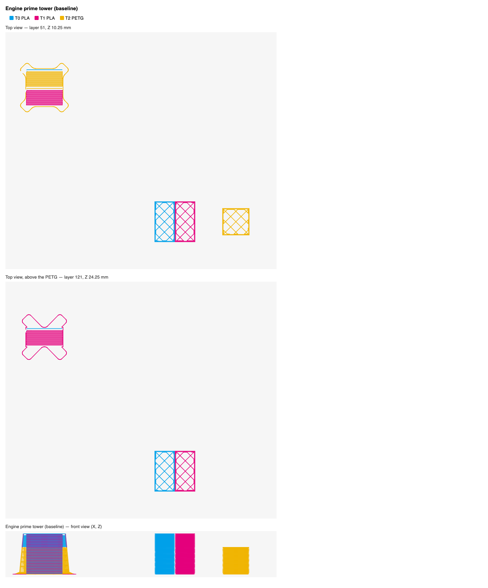

# One prime tower per material

## Goal

The engine prints **one prime tower per plate**: every head primes on it,
layer on layer (`Print.hpp`, `m_wipe_tower_data`; native support is asked
for in OrcaSlicer [#8474](https://github.com/SoftFever/OrcaSlicer/issues/8474)).
When the plate mixes materials that do not bond (PLA and PETG, PLA and
TPU…), that tower stacks PETG layers on PLA layers: it comes off or
collapses. Today the slice sheet can only say so (`slice.tower.conflict`)
and offer "No tower" or an outer wall in one material (#35, #36).

Snap Studio offers the community workaround, generated for the user:
**small pillars, one per group of materials that bond**, printed as ordinary objects, with
the engine's tower turned off.

- A group printed by **one head** gets a plain tube.
- A group printed by **several heads** gets **one pillar of concentric
  rings**, one ring per head: each head primes on its own ring, the rings
  bond to each other because they are the same material.
- **One pillar per head** stays available (a per-group option, and the
  fallback when a ring pillar finds no room).
- The pillars are generated in the 3MF sent to the engine (walls only, no infill, no top or
  bottom layers), as tall as their head's last layer, **first in the object
  list** with `print_order = as_obj_list`. They are never saved in the
  user's project: Snap Studio regenerates them at every slice.
- In Prepare they show as the grey translucent boxes of #36's tower, placed
  side by side automatically, moved like it (the row can be turned).

The feature lives under #36's « Tour d'amorçage » switch: it is a way to
print the prime tower, **always the user's choice**, offered only on plates
whose materials do not bond. The default stays the engine's single tower.

## The feasibility test (done)

Run by Claude Code on the Mac with the app's bundled engine command line
(Snapmaker Orca 2.4.0), the U1 0.4 profile at 0.20 mm Standard, on current
`main`. The plate:

- a 30 mm PLA cube in two halves, on T0 and T1;
- a 20 mm PETG cube on T2;
- a PLA pillar of two concentric rings, outer on T0, inner on T1;
- a PETG pillar (a single tube) on T2.

Pillars set per object to 0 % infill and no top or bottom layers; the
engine's tower off.

What the G-code shows:

1. **Each ring is printed only by its own head.** No ring point belongs to
   another head, and the two touching rings bond. The pillars print walls
   only: the per-object settings are honoured.
2. **Each head prints its pillar before the model** in all 400 checked
   layer × head cases with `print_order = as_obj_list`. With the default
   order, the PETG cube came before its pillar on all 100 PETG layers:
   **list order is required**.
3. **Heights are right**: the PLA pillar stops at 30.05 mm and the PETG one
   at 20.05 mm, as their models.
4. **No new warnings.** With the tower off, the engine adds no tower and
   extrudes nothing outside the objects.
5. **The benefit**: on every tool change the U1 primes its nozzle where it
   stands. With no tower and no pillars, those 248 blobs land on the model;
   with pillars, all 248 land on the pillars.

| Variant | Print time | Filament |
|---|---|---|
| Engine tower | 1h40m41 | 35.96 g |
| Ring pillars | 1h03m20 | 23.05 g |
| One pillar per head | 1h02m37 | 22.67 g |
| No tower, no pillars | 49m50 | 15.67 g |

Every variant has the same 250 tool changes. The engine's tower mixes PETG
and PLA layers in one tower — the problem this plan fixes. On this plate the
ring pillars save about 37 minutes and 13 g against it; one pillar per head
behaves the same, about 40 s faster, and takes more room.

Previews (layer 51 with all heads, layer 121 above the PETG, a front view,
colored by head), in `docs/mockups/per-material-towers/`:

| Ring pillars | One pillar per head | Engine tower |
|---|---|---|
|  |  |  |

The test files (3MF, G-code, the checking scripts) are on the Mac in
`/tmp/snapstudio-per-material-towers/`: **start from their pillar
dimensions** and port their checks to the opt-in test below.

## What Snap Studio has today

- **Prime tower** (#36) — `ui/tower-logic.js` (pure: `ptState`, `ptOn`,
  `ptEstimate`, `ptCorners`, `ptExtent`, `ptTurn`, `ptConvexOverlap`,
  `ptBedState`, `ptSpot`, `ptSizeKey`), `ui/prepare-tower.js`
  (`PR.tower = { on, x, y, rot, real }`, `prTowerHeads`, `prTowerState`,
  `prTowerShown`, `prTowerBox`, `prTowerEnsurePlaced`, `prTowerToSpot`,
  `prTowerCheck`, `prTowerHit`, `prTowerDraw`, `prTowerRenderSwitch`
  (`#p-tower-sw` under the object list), `prTowerRenderProps` (inspector),
  `prTowerSheetWarning` (`#s-tower-place`), `prTowerBlocks`,
  `prTowerOverrides` → `wipe_tower_x/y/rotation_angle`).
- **Slice sheet** — `ui/slice-adv.js`: `advTowerOn`, `advTowerHeads`
  (`{ n, material }`), `advWarnHeads`, `advRenderTower` (`#s-tower`: the
  conflict line with "No tower" and "Outer wall in …"), the
  Multi-material ⚙ group (`wipe_tower_filament`, `prime_tower_width`,
  `prime_volume`, `prime_tower_brim_width`); `#s-tower-sw` shares
  `enable_prime_tower` with Prepare. `ui/slice.js` builds the request:
  `overrides: { ...advOverrides(), ...spdOverrides(), ...prTowerOverrides() }`,
  `scene`, `virtual_heads`.
- **Materials that bond** — `ui/spoolcheck.js`: `spBonds(a, b)` (true /
  false / null from `SP_BOND`, `SP_NO_BOND` and same family),
  `spMaterialFamily`, `spTowerAdvice({ heads, tower, wall })` →
  `{ state, pairs, families }`. #64's creation block uses `spBonds` too
  (`ui/virtual.js`). This table is already on `main`: **#37 does not need
  #16**.
- **Virtual heads** (#64) — `ui/virtual-logic.js` `vhPhysical(set, list)`
  expands virtual values to their two physical heads; `prTowerHeads` already
  uses it.
- **Engine side** — `src-tauri/src/plate.rs`: `SceneItem`, `write_scene` /
  `write_items` (placement, bed checks, `parts_by_head`), `save_scene` +
  `TowerPlace` (`Metadata/project_settings.config`), `tower_of`;
  `src-tauri/src/write3mf.rs` `write_objects` / `write_composites` (objects
  in list order, `Metadata/model_settings.config` with `name` and
  `extruder` per object and part, **no other per-object keys yet**);
  `src-tauri/src/slice.rs` `Request` (`overrides`, `scene`,
  `virtual_heads`), `presets::prepare` merges `overrides`;
  `src-tauri/src/gcode.rs` `Seg { layer, feature, tool, … }`, `TowerBox`,
  `tower_box` (`;TYPE:Prime tower`, feature 10).

## When pillars are used

The switch stays « Tour d'amorçage », on or off, kept with the plate. When
it is on and the tower can be printed (`ptState`: two heads or more, layer
by layer), the **tower kind** is:

- **Single** — the engine's tower, as today;
- **Per material** — the pillars.

The rule (decided on review):

- **Always a choice, never automatic.** The default kind is **single**,
  on every plate, including plates whose materials do not bond. Snap Studio
  never switches to pillars by itself.
- **Offered only when the materials do not bond**: the heads the plate
  prints with (`prTowerHeads`, virtual heads expanded) hold two materials
  for which `spBonds` is **false**. Plates whose materials all bond (or are
  not known) never see the choice and keep the engine's tower.
- **In Prepare**: under the switch, a small segmented control
  « Une tour » / « Par matériau » (single selected by default) with the
  reason « Ces matériaux n'adhèrent pas entre eux : une tour commune se
  décollerait. ». With « Par matériau », the line lists the groups:
  « Une tour par matériau : PLA (T0, T1) · PETG (T2) ».
- **The choice is kept on the plate** (`PR.tower.kind`). If the plate
  changes so that its materials all bond again, the control hides and the
  single tower is printed; the choice comes back with the conflict.

The slice sheet's conflict line (`advRenderTower`) gets a third button,
« Une tour par matériau », next to "No tower" and "Outer wall in …" (the
same choice as Prepare's control, kept in sync); with pillars on, the line becomes an information line
« Une tour par matériau : PLA (T0, T1) · PETG (T2) » and the
`wipe_tower_filament` warning goes away (there is no shared tower any more).

## Groups

Built from the heads the plate prints with, `prTowerHeads()` as it is (its
objects' colors in both association modes, the heads chosen for supports,
walls or infill, virtual heads expanded to their two physical heads, orphans
none), each with its material (`advTowerHeads`' rule: the profile's type,
else its name; from Prepare: `headsProfile` as `advHeadChoices` does).

- Two heads are in the same group when `spBonds` says **true**. A pair that
  is `null` (not known) gets **separate pillars**: it costs a little room,
  never a tower that may come off.
- Groups are cliques: a head joins a group only if it bonds with every head
  already in it (ABS bonds with ASA, ASA with ABS: one group; PETG and PET
  and PCTG: one group).
- A head with no known material is a group of its own.
- Order: groups by their lowest head, heads inside a group by height (see
  below), the tallest outside.
- A **virtual head** puts both its components in the plate's heads; #64
  blocks creating one from materials that do not bond, so they normally land
  in the same group. A virtual head made before its spools changed (flagged
  ⚠ by #64) may split: each component then primes on its own group's
  pillar, which is right.

Pure function `pmGroups(heads)` in a new `ui/pillar-logic.js`.

## Heights

A pillar is printed at every layer up to its height, and each layer forces
its head: the height must be **the last layer where that head prints**.

- **Per ring, not per group**: rings are separate parts, so each ring stops
  at its own head's last use. The tallest ring is the outer one (a wide
  base for the tallest tube); a shorter inner ring simply ends inside it.
- **Objects and parts assigned to a head**: the top of each sliced object
  (`plSliced`) per head, from the placed mesh (`shape(o).zmax - zmin`), for
  every color of the object that goes to that head (`prSliceHeads(o)` /
  `prHeads`).
- **Painted colors** (`paint_color`, #7): the highest painted triangle of
  each color, from the mesh Prepare already has (the per-triangle states
  `prColors` reads), placed and scaled. Painting is on the surface, so this
  is the real last layer to within one layer. **No first slice is needed**;
  if the mesh is not loaded at full detail (dense files, #28's budget),
  fall back to the object's top for every head it paints with (taller,
  safe).
- **Supports, walls or infill sent to another head** (`advHeads`): that head
  is used up to the top of every object with supports (supports) or up to the
  object's top (walls, infill). Taller than needed at worst, never shorter.
- **Virtual heads**: both components up to the top of what uses the virtual
  head.
- Rounded **up** to the next layer (`layer_height`, first layer included).
  The same height as the model is enough: in CC's test the PLA pillar
  stopped at 30.05 mm and the PETG one at 20.05 mm, as their models, and
  every tool change still landed on a pillar.
- After a slice, `gcode.rs` can read each tool's last layer
  (`Seg.tool`, `Seg.layer`, feature ≠ the pillars'): if a ring was more than
  two layers taller than needed, the next estimate uses the slice's value
  (kept like `PR.tower.real`, keyed by what the heights depend on,
  `ptSizeKey`'s idea). This is a refinement, not needed for a first
  version.

## Shape

Round tubes, as tested (see the previews); drawn in Prepare as their
bounding square, the agreed grey box.

- **Ring**: a closed tube part (outer and inner cylinder walls, 48 sides),
  printed with walls only: 2 perimeters on each side of the tube. Rings of
  a pillar touch (no gap), so they bond.
- **Sizes are automatic** (decided: no size setting). Constants in
  `ui/pillar-logic.js`, to tune from CC's test files: innermost ring outer diameter 12 mm; each ring ~2 mm thick
  (about 4 lines at 0.45 mm); a one-head tube 15 mm. Two heads: about
  16 mm; four heads: about 24 mm.
- **Stability**: a tall thin tube can be knocked over by the nozzle. The
  diameter grows with the height: at least `h / 8` (a 160 mm pillar is
  20 mm wide). Each pillar gets a 3 mm outer brim (per object).
- **Per-object settings** written for each pillar in
  `Metadata/model_settings.config`:
  `sparse_infill_density = 0%`, `top_shell_layers = 0`,
  `bottom_shell_layers = 0`, `wall_loops = 2`, `brim_type = outer_only`,
  `brim_width = 3`, `enable_support = 0`, `seam_position = aligned`
  (`ironing_type = no ironing`, `fuzzy_skin = none` so the plate's
  settings never reach them).

## Placement in Prepare

- The pillars of a plate are placed **side by side in one row** with a 3 mm
  gap, the row treated as one box by `ptSpot` (corners first, back-left
  being the engine's default, then the first free place): the same rules
  and the same code as #36's tower.
- No free spot for the row: each pillar is placed on its own (`ptSpot` per
  pillar, smaller boxes fit into gaps). Still none for a ring pillar: it is
  **split into one pillar per head**, which fit in smaller gaps; still none:
  the engine's default place with the overlap shown, as today
  (`prepare.tower.no_spot`).
- Each pillar can be **selected and moved** like #36's tower
  (`prTowerHit`, `prTowerSelect`, the inspector's position fields, the menu with « Placer à un endroit libre » and
  « Désactiver la tour d'amorçage »). Moving one pillar does not move the
  others. « Placer à un endroit libre » places the whole row again.
- **Turning**: a round tube looks the same at any angle, so a pillar has no
  rotation of its own. The turn (inspector field, as the tower's) turns
  **the row** around its middle while its pillars are still side by side,
  to fit it along another edge; a pillar moved out of the row has only a
  position.
- Overlap with a part, off the plate, partly off: the same tints, inspector
  warnings, sheet warning (`#s-tower-place`) and slicing block
  (`prTowerBlocks`) as the tower, for each pillar.
- The inspector of a pillar: its name (« Tour d'amorçage · PLA »), its heads
  as head tokens (T0 outer, T1 inner), its size (read only, exact: Snap
  Studio makes it; no size field), its position (and the row's turn), and
  a switch « Une tour par tête » for that group (rings by default ↔ one
  per head). The prime
  volume slider is **not** shown: with the engine's tower off it does
  nothing (the U1 primes by its own tool-change macro).
- Hover label: « Tour d'amorçage · PLA (T0, T1) 16 × 16 × 30 mm ».

### State

`PR.tower` grows, saved with the plate and its undo steps
(`prTowerStored` / `prTowerRestore`, old plates load as `kind` single and
no pillars):

```js
tower: {
  on, x, y, rot, real,            // as today: the engine's tower
  kind: "single",                 // "single" (default) | "material": the user's choice
  row: { rot: 0 },                // the row's turn while its pillars are together
  pillars: {                      // by group key, e.g. "PLA" or "PETG+PCTG"
    PLA: { x, y, split: false, moved: false },
  },
}
```

Groups are recomputed from the plate on every change; a group key that
appears gets an automatic place, one that disappears is forgotten. Positions
are the pillar's center (the `ptTurn` dance around the tower's corner is not
needed).

With **#18 (several plates)**, `PR.tower` becomes per plate as it is meant
to; the pillars come with it at no extra cost. Without #18, one plate, as
today.

## Engine side

- `slice.rs` `Request` gets `pillars: Vec<Pillar>`:
  `Pillar { x, y, rings: Vec<Ring>, brim: f32 }` (center),
  `Ring { head: u8, d_out: f32, d_in: f32, h: f32 }` (physical head 0–3,
  outer ring first). Empty: as today.
- `plate.rs` `write_items` builds each pillar's mesh (closed tubes,
  watertight, one part per ring, `extruder = head + 1`) and **puts the
  pillars first** in the object list, before the scene's objects. A pillar
  off the plate or on a part stops the slice like a part does (the UI
  already blocks it).
- `write3mf.rs`: objects carry optional per-object settings
  (`settings: Vec<(String, String)>`), written as `<metadata key=… value=…/>`
  in the object's block of `model_settings.config` (Orca reads them as the
  object's config).
- Overrides sent with pillars (`prTowerOverrides` returns these instead of
  the tower's place): `enable_prime_tower = 0`, `print_order = as_obj_list`,
  `independent_support_layer_height = 0` (a support layer between two
  object layers would change heads where no pillar layer is). These win
  over the sheet's differences.
- `print_sequence = by object` (#22): no pillars either, as no tower
  (`ptState` reason `by_object`).
- The G-code's `;TYPE:Prime tower` is absent: `tower_box` returns `None`, as
  it should. The pillars are objects named « Tour d'amorçage · PLA »
  (translated name): Moonraker's object list and the preview show them as
  such.
- **The 3MF sent to the engine** (`write_scene`, the slice's
  `plate.3mf`) contains the generated pillars, first in the list, with their
  per-object settings. It is a work file, never shown or saved.
- **Saving the plate** (`plate_save` / `save_scene`) writes **only the
  user's parts**, never the pillars (decided). #36's tower is kept today in
  `Metadata/project_settings.config` with Orca's own keys
  (`enable_prime_tower`, `wipe_tower_x` / `wipe_tower_y`,
  `wipe_tower_rotation_angle`), and `plate_tower` (`plate.rs` `tower_of`)
  reads it back, trusting the switch only when the file's application is
  Snap Studio (`ours`). The pillars follow the same idea, with Snap Studio's
  own data in a separate entry, `Metadata/snapstudio_tower.json`
  (`write3mf::append_entry`): `{ kind, row: { rot }, pillars: { <group
  key>: { x, y, split, moved } } }`. Orca ignores an unknown entry.
  `plate_tower` returns it with the tower, read only when `ours`; opening
  the file on an empty plate restores the choice and the pillars' places,
  and the pillars are regenerated at the next slice.
- **In Snapmaker Orca** the saved file has **no pillars**: it gets the
  switch and the single tower's place, as today, so Orca prints its own
  single tower if the switch is on. Said nowhere in the UI.
- **Object order**: with `as_obj_list`, the user's objects also print in
  list order inside a layer. That is the order of Prepare's list today; say
  it nowhere unless #22 adds a reorderable list.

## Interactions

- **Slice sheet levels** (#63): the information line and the third button
  are shown in Basic and Advanced (they are the tower's state, not a
  setting). With pillars, the tower group of the Multi-material ⚙
  (`wipe_tower_filament`, `prime_tower_width`, `prime_volume`,
  `prime_tower_brim_width`) is disabled with « Ces réglages concernent la
  tour unique. ».
- **Virtual heads** (#64): see Groups and Heights. A virtual head on a
  plate whose tower is off keeps #64's hint.
- **Spool check before sending** (`spoolcheck.js`): unchanged; rerouting a
  head through the extruder map reroutes its ring too, which is right (the
  ring is that head's).
- **#16 (plate / material warnings)**: independent. #16 is about the build
  plate under a material; the bonding table it would extend is already in
  `spoolcheck.js`. If #16 lands first and moves the table, `pmGroups` reads
  it from there.
- **#18 (several plates)**: see State; nothing blocks this plan.
- **#22 (by object)**: no tower of either kind in that sequence.
- **AI tab, printer 3D view, Files**: nothing.

## Texts (EN / FR)

`ui/i18n/en.json` and `fr.json` (names are suggestions):

| Key | EN | FR |
|---|---|---|
| `prepare.tower.kind` | Tower | Tour |
| `prepare.tower.kind.single` | One tower | Une tour |
| `prepare.tower.kind.material` | Per material | Par matériau |
| `prepare.tower.per_material` | One tower per material: {list} | Une tour par matériau : {list} |
| `prepare.tower.per_material_why` | These materials do not bond: one shared tower would come off. | Ces matériaux n'adhèrent pas entre eux : une tour commune se décollerait. |
| `prepare.tower.pillar` | Prime tower · {m} | Tour d'amorçage · {m} |
| `prepare.tower.pillar_size` | Prime tower · {m} ({heads}) {size} mm | Tour d'amorçage · {m} ({heads}) {size} mm |
| `prepare.tower.split` | One tower per head | Une tour par tête |
| `prepare.tower.split_sub` | Takes more room; same result. | Prend plus de place ; même résultat. |
| `prepare.tower.split_auto` | Not enough room for one tower: one per head. | Pas assez de place pour une tour : une par tête. |
| `slice.tower.per_material` | One tower per material | Une tour par matériau |
| `slice.tower.per_material_on` | One tower per material: {list}. | Une tour par matériau : {list}. |
| `slice.tower.single_only` | These settings are for the single tower. | Ces réglages concernent la tour unique. |

`{list}` is « PLA (T0, T1) · PETG (T2) ». Existing FR strings that still say
« tour de purge » (`slice.tower.conflict`, `slice.tower.walled`) become
« tour d'amorçage » at the same time. `python3 scripts/check-i18n.py` must
stay clean.

## Tests

- `scripts/test-pillars.js` (new, pure `ui/pillar-logic.js`):
  - `pmGroups`: PLA + PLA + PETG → [PLA (T0, T1)], [PETG (T2)]; ABS + ASA
    one group; PETG + PCTG + PET one group; a `null` pair split; unknown
    material alone; virtual head components; orphans ignored;
  - `pmKind`: single by default, also when materials do not bond; the
    choice offered only when a pair does not bond (`null` pairs: not
    offered); « Par matériau » kept, falling back to single while the
    materials all bond; `by object` and single head → none;
  - heights: per head from objects, from painted triangles, from support /
    wall heads, virtual heads, rounding up to the layer;
  - sizes: ring diameters, the `h / 8` rule, the bounding box;
  - layout: one row in a free corner, per-pillar fallback, split
    fallback, no spot at all; group keys appearing and disappearing keep the
    others' places;
  - overrides: `enable_prime_tower 0`, `print_order as_obj_list`,
    `independent_support_layer_height 0`, no `wipe_tower_x`.
- `scripts/test-tower.js`: the single tower unchanged; `PR.tower` old
  plates restore with `kind` single and no pillars.
- `scripts/test-adv.js`: the conflict line's third button; the information
  line with pillars; the tower group disabled.
- `cargo test --lib`:
  - `plate.rs`: a pillar mesh is closed and manifold, its rings' extruders,
    pillars first in `write_items`' list, an off-plate pillar refused;
  - `write3mf.rs`: per-object settings in `model_settings.config`, read back;
  - `write_scene` with pillars: the pillars are in the engine's 3MF, first;
  - `save_scene` with pillars: only the user's parts, the
    `snapstudio_tower.json` entry; `plate_tower` reads it back (only for a
    Snap Studio file).
- **Opt-in engine test** (`#[ignore]`, as `engine_prime_tower_position`:
  `SNAPSTUDIO_ENGINE=… cargo test --lib engine_material_pillars -- --ignored --nocapture`),
  CC's plate rebuilt through the real code path (scene + `pillars`), its
  G-code read with `gcode.rs`:
  1. every extrusion inside a ring's footprint is by that ring's head;
  2. for each layer and head, the head's first extrusion is on its pillar
     (and with `print_order` default, the test shows it is not: kept as a
     guard that the override is sent);
  3. each ring's last layer matches its head's last layer on the model
     (± one layer);
  4. no `;TYPE:Prime tower`, nothing outside the objects;
  5. the tool changes land above the pillars (the position of each `T<n>`).
- Screenshots (light / dark, FR / EN): Prepare with a PLA + PETG plate and
  its two pillars, the « Une tour / Par matériau » control with single
  selected, a pillar selected with its inspector, the split variant,
  the slice sheet's conflict line with its third button and the information line, the
  sliced preview.

## Risks

- **Print time**: each pillar forces its head at every layer up to its
  height. On CC's plate the pillars are still 37 minutes faster than the
  engine's tower, but slower than no tower (+13 min).
- **A head used at the bottom and again near the top** gets a layer on its
  ring at every layer in between, so extra tool changes there. The engine's
  tower does the same; a ring cannot skip layers. Said nowhere in the UI for
  now.
- **Object order**: some users report `as_obj_list` not always respected
  (a support printed before the pillar). Not seen in CC's test (400 / 400);
  the opt-in test guards it, and a check on the U1 is in the list below.
- **Independent support layer height** is forced off with pillars.
- **No purge volume**: with the engine's tower off, `prime_volume` and the
  flushing volumes do nothing; the U1's tool-change macro primes in place,
  the blob lands on the pillar. Colour changes of the same material (PLA
  T0 → PLA T1) may show a little bleed on the model's first lines after a
  change; to look at on a real print.
- **Thin tall pillars** may be knocked over: the `h / 8` rule and the brim.
- **Painted heights** from the display mesh: a simplified mesh gives the
  object's top (safe, taller).

## To check on the U1

- A PLA + PETG plate printed with pillars: they stand, the PETG pillar
  does not touch PLA, the blobs land on the pillars.
- The order on a plate with supports.
- Colour bleed on same-material changes, against the engine's tower.

## Decisions taken on review

1. **Always a choice**: pillars are never switched on automatically. When
   the materials do not bond, « Une tour / Par matériau » is offered in
   Prepare (under the tower switch) and on the slice sheet's conflict line;
   the default stays the single tower.
2. **Only when materials do not bond**: not offered on other multi-head
   plates.
3. **Rings by default**; one pillar per head as the fallback when space is
   short and as a per-group option.
4. **Not saved in the 3MF**: the saved project holds only the user's
   parts, with the choice and the pillars' places as Snap Studio data
   (`Metadata/snapstudio_tower.json`); the pillars are regenerated at
   slicing and are always in the 3MF sent to the engine. Opened in
   Snapmaker Orca, the file has no pillars.
5. **Automatic sizes**: no size setting in the inspector.

## Docs (later)

- README and site: in the 0.16 batch, one short line.
- CHANGELOG: the line under *Unreleased* in the implementation PR.

## As implemented

Where the code differs from the text above, or settles what it left open:

- **State**: `PR.tower.groups` holds each group's split (`true` chosen,
  `"auto"` forced for room, forgotten by « Placer à un endroit libre »);
  `PR.tower.pillars` holds each pillar's center by **pillar** key (`"PLA"`,
  or `"PLA/T1"` once split) with `moved`. `kind` and `row` as planned.
  Undo steps hold the places, groups and row; `kind` is a setting, as the
  switch.
- **Placement**: a pillar that appears (a new material) takes a free place
  as a row of its own; the others keep theirs, and one that goes is
  forgotten. A group split or joined again in a row nobody moved: the row
  is laid out again; once a pillar was moved by hand, the new ones take a
  place of their own. « Placer à un endroit libre » lays the row out again.
- **Inspector**: the section is « Centre »; the row's turn shows while the
  pillar is still in a row of several. A split pillar is named with its
  head (« Tour d'amorçage · PLA (T1) »), in the inspector and in the
  engine's object list.
- **Sizes**: rings 2 mm thick around an 8 mm hole (12 / 16 / 20 / 24 mm for
  one to four heads), a one-head tube 15 / 11 mm, at least `h / 8` wide; the
  box drawn and checked includes the 3 mm brim.
- **Slice sheet**: the information line has a « Une tour » button, the way
  back, as Prepare's control.
- **Saved file**: the tower's place is saved whenever the switch is on (the
  engine's default place, 15 / 220, if Prepare never showed the single
  tower); `snapstudio_tower.json` is read even without it.
- **Engine**: `slice.rs` also forces the three overrides whenever a request
  has pillars, whatever the sheet sends.

## For the implementer

Implement, then **review your whole diff against `main`**: every reader of
`PR.tower` (`rg "PR\.tower|prTower"`), the slice request and the saved
3MF (never any pillar) and the engine's 3MF (always the pillars), undo steps, virtual heads and orphans, i18n,
themes, keyboard. Fix what you find and report that review in the pull
request. Run the opt-in engine test on the Mac and paste its output.
